# R10 Editör Düzeltici

R10.net için Chrome eklentisi (Manifest V3). R10 editörünün **Önizle / Konuyu Aç / Cevap Gönder** sırasında yazı boyutlarını, boş satırları ve aralıkları bozmasını kalıcı olarak çözer; üstüne R10'un tüm özelliklerini içeren **modern bir editör**, **görsel boyutlandırma** ve **Türkçe yazım/imla düzeltme** ekler.

> Sürüm: **1.6.2** · Chrome 111+ · Yalnızca `r10.net` üzerinde çalışır

> 💻 **Tamamen yerel (local) çalışır:** harici sunucu, analiz veya izleme kullanmaz; yazdığın metin hiçbir yere gönderilmez. Ayrıntılar: [Gizlilik ve ağ erişimi](#gizlilik-ve-ağ-erişimi).
>
> 🛠️ Bu eklenti bir **hobi projesi** olarak geliştirilmiştir.

<p align="center">
  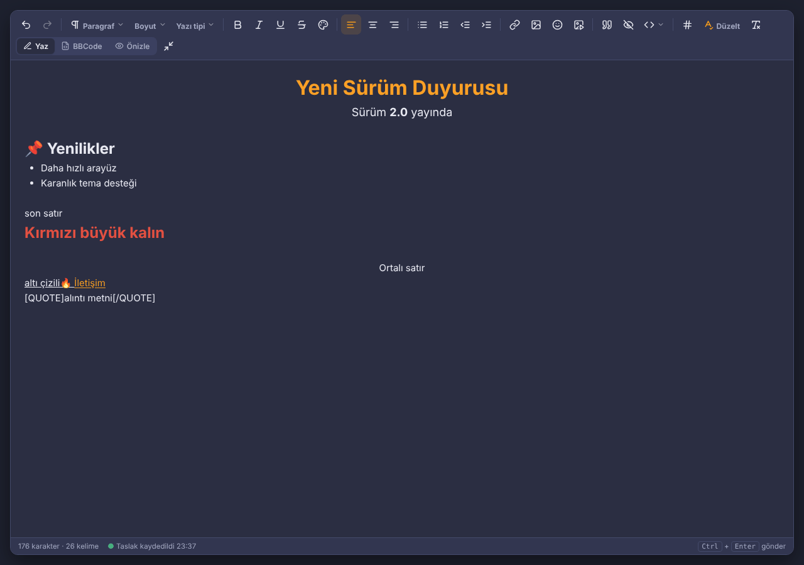
  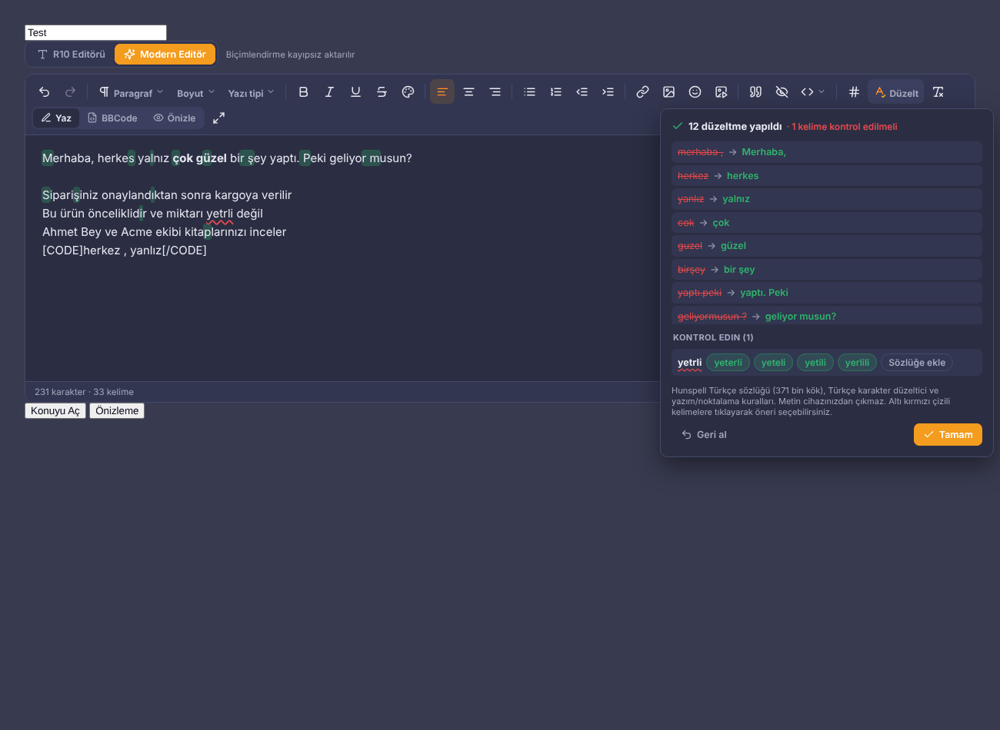
</p>

---

## İçindekiler
- [Sorun](#sorun)
- [Çözüm](#çözüm)
- [Özellikler](#özellikler)
- [Ekran görüntüleri](#ekran-görüntüleri)
- [Kurulum](#kurulum)
- [Mimari](#mimari)
- [Klasör yapısı](#klasör-yapısı)
- [Geliştirme](#geliştirme)
- [Gizlilik ve ağ erişimi](#gizlilik-ve-ağ-erişimi)
- [Sürüm geçmişi](#sürüm-geçmişi)
- [Katkı](#katkı)
- [Lisans](#lisans)

---

## Sorun
R10'daki editör (Froala) HTML üretir, forum (vBulletin) ise mesajları **BBCode** olarak saklar. Gönderimde HTML sunucuda BBCode'a çevrilir ve bu çeviri kayıplıdır:

| Yazılan | Önizleme / gönderim sonrası |
|---|---|
| Enter ile bırakılan boş satırlar | Silinir |
| 24px, 32px, 48px yazı boyutları | Tamamen düşer |
| Liste sonrası boş satır | Kaybolur |
| İki biçimli kelime arasındaki boşluk (`[/SIZE] [SIZE]`) | Silinir, kelimeler bitişir |
| Bölünemez boşluk (nbsp) | Bozuk karaktere dönüşür |
| R10 editöründe eklenen emojiler | Kaybolur |

## Çözüm
Eklenti gönderim anında editör içeriğini **kendi kayıpsız HTML → BBCode dönüştürücüsüyle** çevirir ve forma BBCode olarak koyar (R10'un kendi "Kaynak" modunun kullandığı yol). Sunucu bu metni olduğu gibi saklar. Önizleme sonrası editöre dönen içerik de birebir aynı BBCode'a geri çevrilir; art arda önizlemelerde hiçbir şey kaybolmaz.

Sunucunun bilinen tuhaflıkları da telafi edilir: blok kapanış etiketlerinden sonra yutulan satır sonu, etiketler arası boşluğun silinmesi, nbsp bozulması.

## Özellikler

### 1. Editör düzeltici (R10'un kendi editörüyle)
- Boş satırlar, 1–7 arası tüm yazı boyutları, renk, yazı tipi, kalın/italik/altı çizili/üstü çizili
- Sola/ortaya/sağa hizalama, girinti, sıralı/sırasız ve iç içe listeler
- Bağlantı, e-posta, görsel (genişlikle birlikte `[IMG=400]`), R10 emojileri
- Elle yazılan `[QUOTE]`, `[SPOILER]`, `[CODE]` vb. etiketler ve yalnızca BBCode içeren satırlar korunur

### 2. Modern editör
R10 editörünün üstüne **R10 Editörü / Modern Editör** seçicisi eklenir; seçim hatırlanır. İki editör arasında geçişte biçim kayıpsız aktarılır.

- **Araç çubuğu:** geri al/yinele, paragraf/başlık, 7 kademe boyut, yazı tipi, renk paleti + özel renk, B/I/U/S, hizalama, listeler, girinti (Tab / Shift+Tab), bağlantı (Ctrl+K), biçim temizleme
- **Sekmeler:** Yaz · BBCode (kaynağı doğrudan düzenle) · Önizle
- Tam ekran modu, karakter/kelime sayacı, **Ctrl+Enter** ile gönderme
- Otomatik taslak kaydı, R10 gece/gündüz temasına uyum
- Yazma alanı içerik kadar uzar; araç çubuğu kaydırırken üstte kalır
- Boş alana tıklayınca yazmaya devam edilir
- **Özel mesajlar:** sohbet ekranında sıkı kip (tek satır araç çubuğu, sınırlı yükseklik) ile mesaj geçmişi daralmaz; taslaklar her konuşma için ayrı saklanır

### 3. R10'un tüm özellikleri
- **Emojiler:** Rokito ve Genel sekmeleri (R10'un kendi seti) + Unicode emoji; R10 kodlarıyla (`:r1:`, `:)`) gönderilir
- **GIF:** Rokito GIF'leri ve Giphy araması (R10'un Giphy servisi, kaydırdıkça yükleme)
- **Hazır Cevaplarım:** listele, ara, ekle, oluştur, düzenle, sil (R10 hesabıyla senkron)
- **Markdown ekle:** canlı önizlemeli; başlık, liste, alıntı, tablo, dil etiketli kod blokları
- **Kod menüsü:** `[CODE]`, `[PHPR]`, `[HTMLR]`, `[CSSR]`, `[JSR]`, `[CODEPEN]`, `[JSFIDDLE]`
- **@kullanıcı etiketleme:** `@` yazınca R10 üye araması, ok tuşları + Enter

### 4. Görseller
- Adresle ekleme, bilgisayardan R10 CDN'e yükleme, yapıştırma ve sürükle-bırak
- **Yüklediklerim galerisi:** daha önce yüklenen görseller; ekle, sil, yeni yükle
- **Görsel menüsü (R10 ile aynı):** Değiştir · Hizala (sol/orta/sağ) · Bağlantı (ekle/aç/kaldır) · Sil
- **Boyutlandırma:** köşelerden sürükle ya da Küçük (200) / Orta (400) / Büyük (640) / Tam / Orijinal / piksel gir
- Yeni eklenen görsel kendi satırında ortalanır ve **seçili gelir**; tutamaçlar ve menü hemen görünür. Seçiliyken yazmak görseli silmez, imleç görselin arkasına geçer.
- Kayıt biçimi: `[CENTER][URL="…"][IMG=400]…[/IMG][/URL][/CENTER]`

### 5. Yazım, imla ve noktalama düzeltme
Araç çubuğundaki **Düzelt** düğmesi (Ctrl+Shift+Y) metni tarar ve otomatik düzeltir; seçim varsa yalnızca seçimi. Düzeltilenler yeşil vurgulanır, listelenir ve tek tıkla / Ctrl+Z ile geri alınır.

Üç katmanlı çalışır:
1. **Kural motoru:** noktalama boşlukları, tekrar eden işaretler, cümle/satır başı büyük harf, özel isimler/markalar, TDK yaygın yanlışları (herkez→herkes, yanlız→yalnız, birşey→bir şey, malesef→maalesef…), soru eki ve "ki" (geliyormusun→geliyor musun, dediki→dedi ki)
2. **Hunspell + Türkçe sözlük** (LibreOffice/OpenOffice Türkçe sözlüğü, ~371 bin kök, tüm ekli biçimler); WASM olarak eklentinin arka plan servisinde çalışır
3. **Türkçe karakter düzeltici** (Deniz Yuret'in bağlamsal deasciifier'ı): "siparisiniz onaylandiktan sonra kargoya verilir" → "Siparişiniz onaylandıktan sonra kargoya verilir"

- Yalnızca emin olunan düzeltmeler otomatik yapılır; şüpheli kelimelerin altı kırmızı çizilir, tıklayınca öneriler / "Tümünü düzelt" / "Sözlüğe ekle" çıkar
- Büyük harfle yazılan özel adlara dokunulmaz
- URL, alan adı, e-posta, @etiket, sayılar (1.250 / 3,5 / 14:30), ifadeler, BBCode etiketleri ve kod blokları korunur

## Ekran görüntüleri
| | |
|---|---|
| 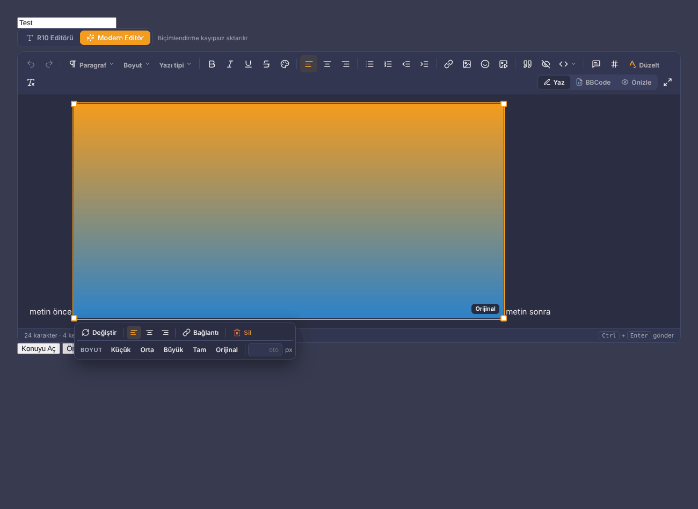 Görsel menüsü ve boyutlandırma | 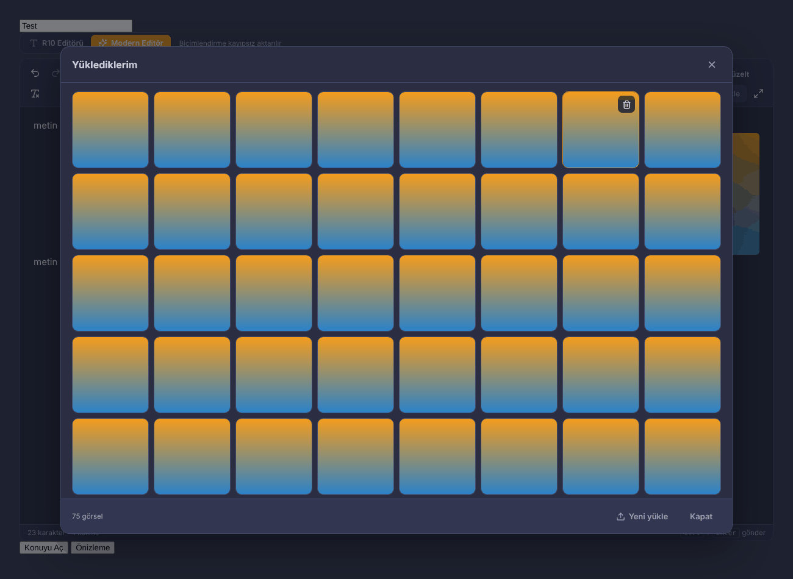 Yüklediklerim galerisi |
| 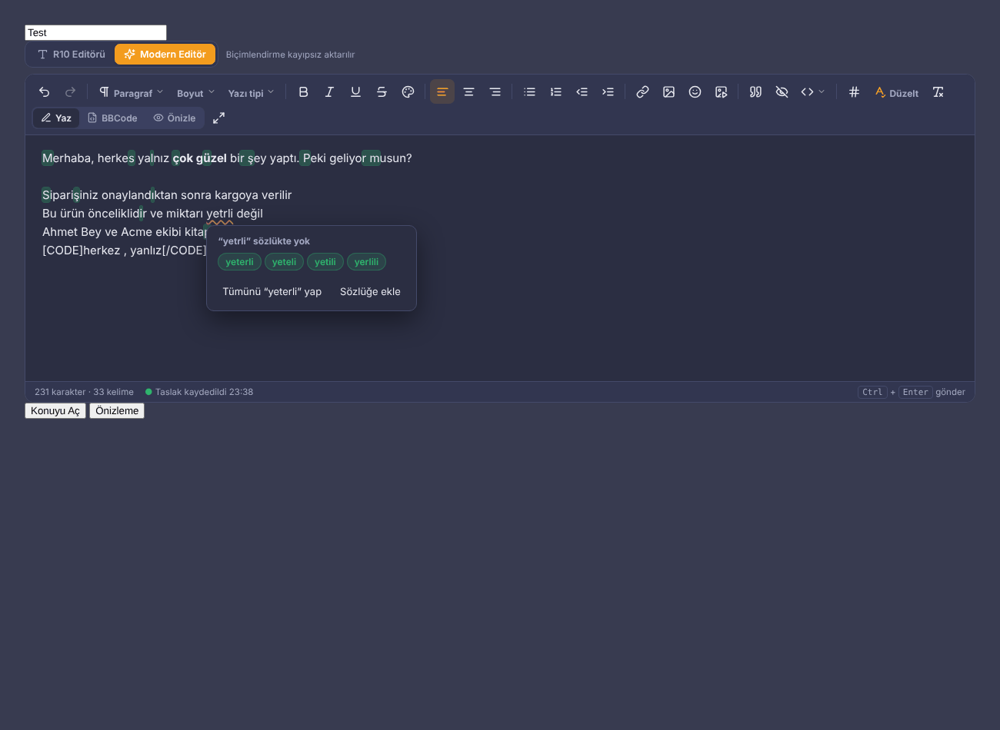 Yazım önerileri | 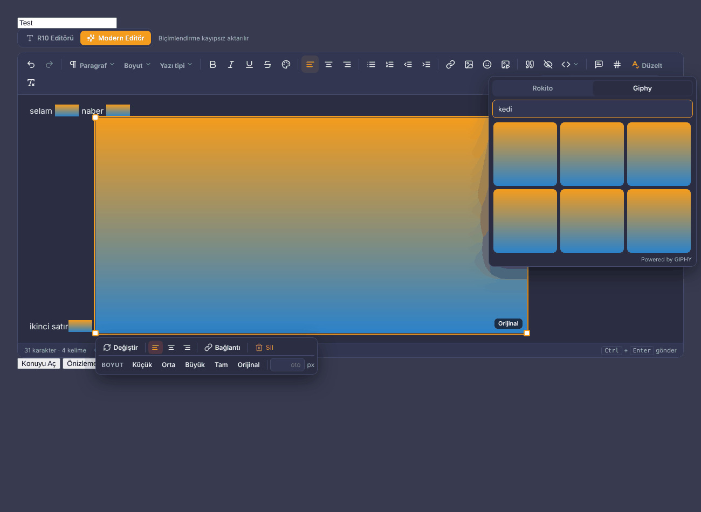 GIF / Giphy |
| 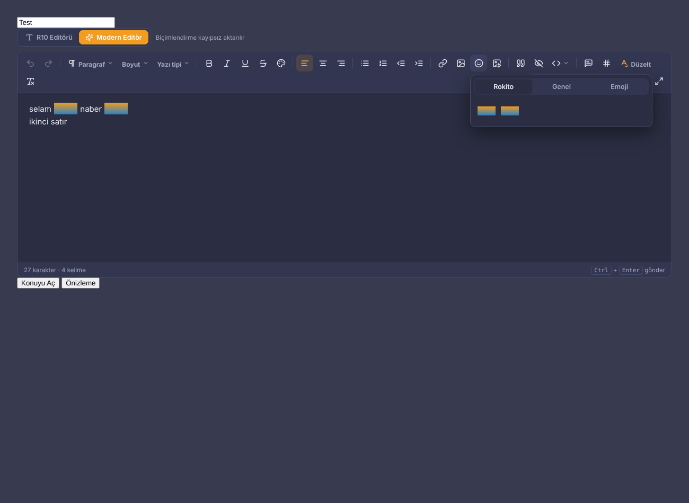 R10 emojileri | 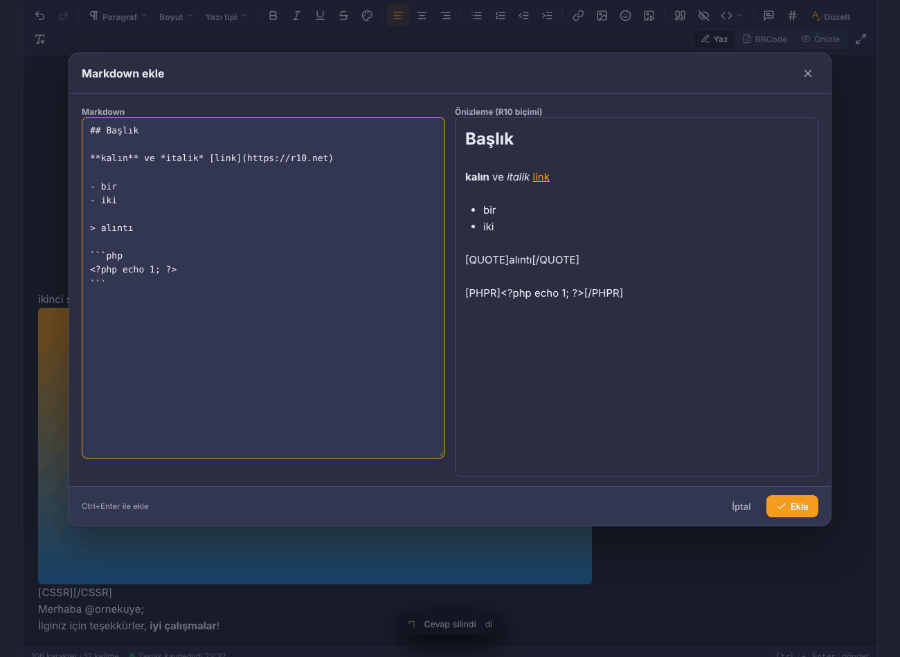 Markdown ekle |
| 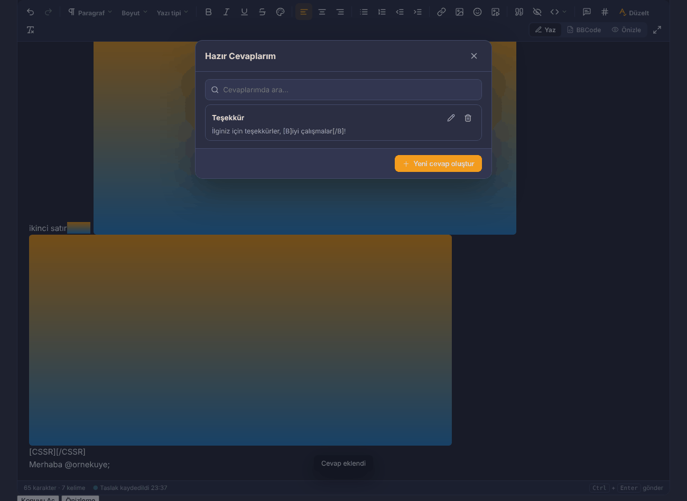 Hazır Cevaplarım | 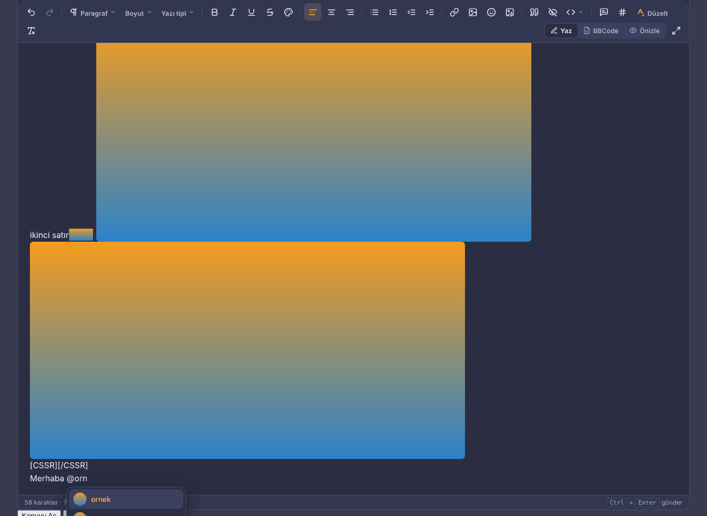 @kullanıcı etiketleme |
| 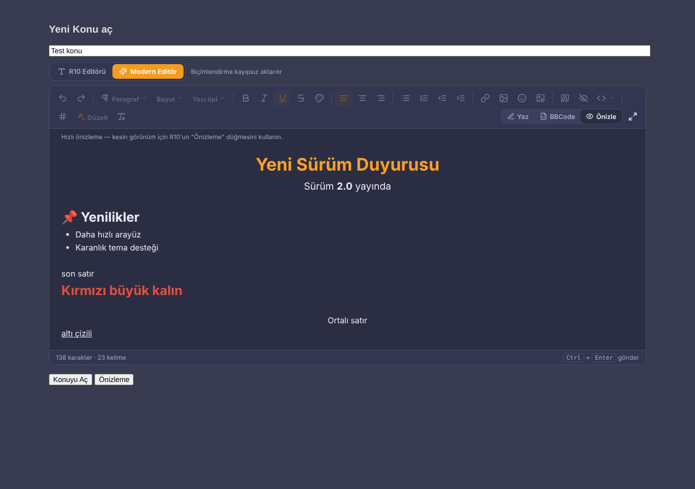 Hızlı önizleme | 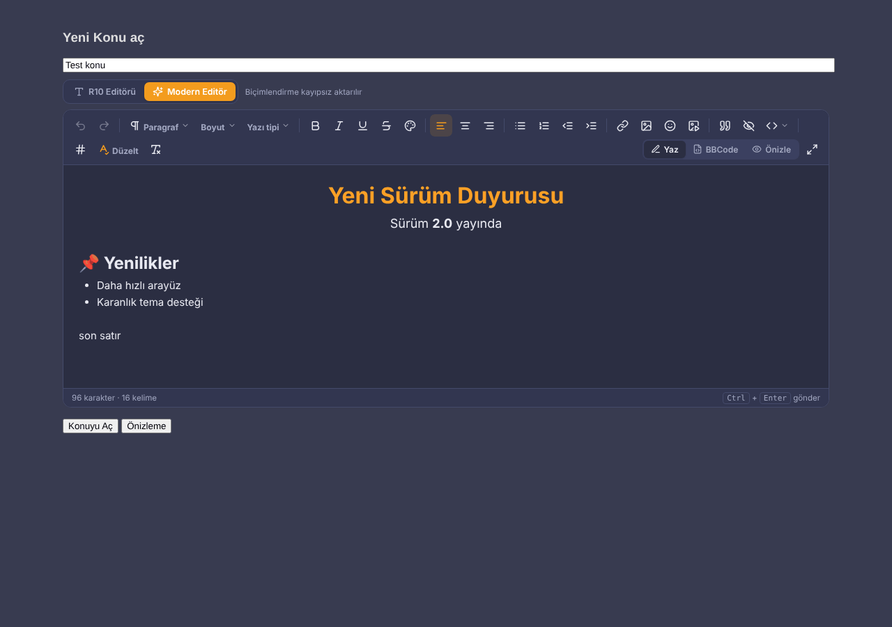 Gece teması |

## Kurulum
1. Depoyu indir (**Code → Download ZIP**) veya klonla:
   ```bash
   git clone https://github.com/cloudviba/r10-editor-fix.git
   ```
2. Chrome'da `chrome://extensions` adresini aç, sağ üstten **Geliştirici modu**nu aç.
3. **Paketlenmemiş öğe yükle** → depodaki **`extension/`** klasörünü seç.
4. Açık R10 sekmelerini yenile.

Araç çubuğundaki eklenti simgesinden **Düzeltici** ve **Modern editör** ayrı ayrı açılıp kapatılabilir.

**Güncelleme:** yeni dosyaları aynı klasörün üzerine kopyala → `chrome://extensions` sayfasında eklentinin yenile (↻) simgesine bas → R10 sekmesini yenile.

## Mimari

```
┌────────────────────── r10.net sayfası ──────────────────────┐
│  MAIN world (sayfa bağlamı, document_start)                 │
│   converter.js     HTML ⇄ BBCode dönüştürücü (window.R10BB) │
│   fixer.js         gönderim / önizleme kancaları            │
│   modern-editor.js Tiptap tabanlı modern editör             │
│        ▲  window.postMessage (__r10spell)                   │
│        ▼                                                    │
│  ISOLATED world                                             │
│   bridge.js        ayarlar (chrome.storage) + mesaj köprüsü │
└────────┬────────────────────────────────────────────────────┘
         │ chrome.runtime.sendMessage
┌────────▼──────────────┐
│ spell-sw.js           │  service worker: hunspell-asm (WASM)
│ dict/tr.aff, tr.dic   │  + Türkçe sözlük, önbellekli
└───────────────────────┘
```

**Gönderim akışı (`fixer.js`):** Gönder/Önizle düğmesine tıklama (capture), form `submit` olayı, `HTMLFormElement.prototype.submit` ve jQuery `serialize`/`serializeArray` yakalanır. İçerik BBCode'a çevrilip `message` alanına yazılır ve form BBCode modunda gönderilir. Froala'nın kendi Kaynak (BBCode) görünümündeyken müdahale edilmez.

**Modern editör (`build/src/modern-editor.js`):** Tiptap v2 (StarterKit, TextStyle, Color, FontFamily, TextAlign, Link, Image, Placeholder, CharacterCount, Suggestion) üzerine özel eklentiler: `FontSize`, `Indent`, `Smilie`, `R10Mention`, `ResizableImage` (NodeView + 4 tutamaç), `ProofHighlight`, `SpellMarks`. R10 uç noktaları güvenlik anahtarı (`SECURITYTOKEN`) ile sayfanın kendi oturumu üzerinden çağrılır.

**vBulletin BBCode notları:**
- `SIZE` 1–7 = 10 / 13 / 16 / 18 / 24 / 32 / 48 px
- `[IMG=N]` genişlik verir; yüzde genişlik desteklenmez
- Hizalama `[LEFT]` / `[CENTER]` / `[RIGHT]`; iki yana yaslama desteklenmez (sola hizalı gönderilir)
- Blok kapanış etiketleri ardından gelen bir satır sonunu yutar; sunucu iki etiket arasındaki boşluğu siler

## Klasör yapısı
```
extension/            Chrome'a yüklenen eklenti (hazır, derlenmiş)
  manifest.json
  bridge.js           ayar + mesaj köprüsü (isolated world)
  converter.js        HTML ⇄ BBCode dönüştürücü
  fixer.js            gönderim / önizleme kancaları
  modern-editor.js    modern editör (esbuild paketi)
  spell-sw.js         yazım denetimi service worker'ı (esbuild paketi)
  popup.html / .js    aç/kapa arayüzü
  dict/               Türkçe Hunspell sözlüğü (dictionary-tr, MIT)
  icons/
build/                derleme kaynakları
  src/
    modern-editor.js  modern editör kaynağı
    styles.css        editör stilleri (pakete metin olarak gömülür)
    tr-proofread.js   kural tabanlı yazım/noktalama motoru
    spell-logic.js    sözlük katmanı: kelime ayırma, uzaklık, karar verme
    spell-sw.js       service worker kaynağı
  build.mjs           modern-editor.js paketini üretir
  build-sw.mjs        spell-sw.js paketini üretir
  test/               birim testleri (dönüştürücü, kural motoru, sözlük)
tests/e2e/            Playwright uçtan uca testleri (sahte R10 sayfası + gerçek eklenti)
docs/screenshots/     ekran görüntüleri
```

## Geliştirme
Gereksinim: Node.js 18+, (uçtan uca testler için) Python 3 + Playwright + Google Chrome.

```bash
cd build
npm install
npm run build     # extension/modern-editor.js ve extension/spell-sw.js dosyalarını üretir
npm test          # kural motoru + sözlük + dönüştürücü birim testleri
```

Uçtan uca testler (headless Chrome, R10 uç noktaları taklit edilir):
```bash
pip install playwright
cd tests/e2e
python3 e2e.py            # modern editör temel akışları
python3 e2e_ext.py        # gerçek eklenti yüklenerek: yazım denetimi servisi
python3 e2e_r10.py        # R10 özellikleri: emoji, GIF, hazır cevaplar, @etiket, yükleme
python3 e2e_imgmenu.py    # görsel menüsü, hizalama, bağlantı, galeri
python3 e2e_autosel.py    # eklenen görselin otomatik seçimi
python3 e2e_pm.py         # özel mesaj ekranı: AJAX gönderimi, sıkı düzen, taslaklar
# diğerleri: e2e_img.py, e2e_proof.py, e2e_click.py, grow_test.py, layout_test.py, sw_test.py
```
Ekran görüntüleri `R10_SHOTS` ortam değişkenindeki klasöre (varsayılan `/tmp/r10-shots`) yazılır. Testler Chrome'u `/usr/bin/google-chrome` yolunda arar.

## Gizlilik ve ağ erişimi
Eklentinin kendisi tamamen yereldir: kütüphaneler pakete gömülüdür, sözlük eklenti klasöründen okunur, harici CDN, analiz veya izleme yoktur. Yazılan metin hiçbir sunucuya gönderilmez. Ayarlar, taslaklar ve "Sözlüğe ekle" listesi yalnızca tarayıcıda saklanır.

İnternete çıkan tek istekler, R10'un orijinal editörünün de kullandığı **R10'un kendi servisleri**dir ve yalnızca ilgili özellik kullanıldığında yapılır:

| Adres | Kullanım |
|---|---|
| `r10.net/ajax.php` | Hazır cevaplar, @üye arama, önizleme dönüşümü |
| `api.r10.net/vb3/cdn/editor` | Görsel yükleme, Yüklediklerim listesi, silme |
| `api.r10.net/vb3/giphy`, `media3.giphy.com` | GIF arama ve önizleme |
| `cdn.r10.net/gifs` | Rokito GIF'leri |

İzinler: yalnızca `storage`; içerik betikleri yalnızca `r10.net` ve alt alan adlarında çalışır.

## Sürüm geçmişi
| Sürüm | Değişiklik |
|---|---|
| 1.6.2 | Özel mesajlarda mesajın `<p>…</p>` etiketleriyle gitmesi düzeltildi; özel mesaj ekranında sıkı editör düzeni (sohbet alanı daralmıyor); taslaklar konuşma bazında; R10'un alıntı ekleme ve editör temizleme işlemleri modern editöre yansıyor |
| 1.6.1 | Eklenen görsel otomatik seçili gelir; seçiliyken yazmak/yeni içerik eklemek görseli silmez |
| 1.6.0 | R10 ile aynı görsel menüsü (Değiştir / Hizala / Bağlantı / Sil), Yüklediklerim galerisi, yazma alanının içerikle uzaması |
| 1.5.x | R10 emojileri, GIF/Giphy, Hazır Cevaplarım, Markdown, kod türleri, @etiketleme; panel taşma düzeltmeleri |
| 1.4.0 | Hunspell + Türkçe sözlük ve deasciifier ile sözlük tabanlı yazım denetimi |
| 1.3.0 | Yazım/noktalama düzeltme düğmesi; boş alana tıklayıp yazmaya devam |
| 1.2.0 | Görsel boyutlandırma, `[IMG=genişlik]` desteği |
| 1.1.0 | Modern editör ve editör seçici |
| 1.0.0 | Kayıpsız HTML → BBCode gönderimi, önizleme düzeltmesi |

## Katkı
Hata bildirimi ve öneriler için [Issues](../../issues) bölümünü kullanabilirsin. Pull request göndermeden önce `npm test` ve uçtan uca testlerin geçtiğinden emin ol.

> Bu eklenti R10.net ile resmi bir bağlantısı olmayan, bağımsız bir topluluk projesidir.

## Lisans
Proje kodu [MIT lisansı](LICENSE) ile dağıtılır.

Pakete gömülü açık kaynak bileşenler: [Tiptap](https://tiptap.dev) / ProseMirror (MIT), [lucide](https://lucide.dev) (ISC), [marked](https://marked.js.org) (MIT), [diff](https://github.com/kpdecker/jsdiff) (BSD-3), [turkish-deasciifier](https://github.com/ustunozgur/turkish-deasciifier) (ISC), [hunspell-asm](https://github.com/kwonoj/hunspell-asm) (MIT), [dictionary-tr](https://github.com/wooorm/dictionaries) (MIT, `extension/dict/LICENSE-dictionary-tr`).
